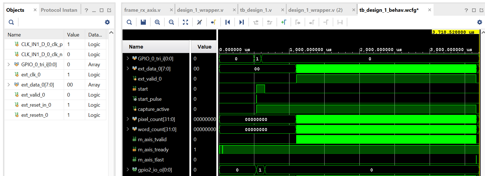
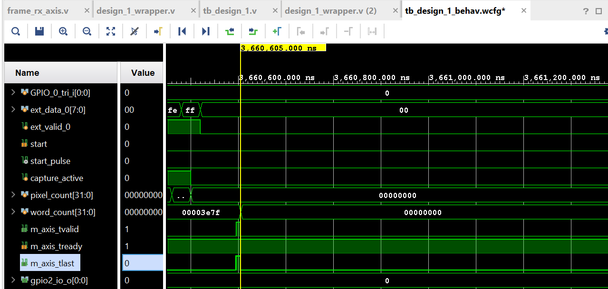
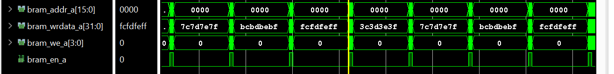

# Homework 12 — MicroBlaze DMA Frame Capture

Frame capture system based on MicroBlaze, AXI DMA and BRAM.

## Task

The design receives an external frame:

- Resolution: `320 x 200`
- Pixel size: `8 bit`
- Frame size: `64,000 bytes`
- AXI4-Stream width: `32 bit`
- Number of AXI words per frame: `16,000`

Capture starts only after a button press handled by MicroBlaze.

---

## Architecture

```text
External 8-bit data
        |
        v
 frame_rx_axis
        |
        v
 Async FIFO
   8-bit -> 32-bit
        |
        v
 AXI4-Stream
        |
        v
 AXI DMA S2MM
        |
        v
 AXI BRAM Controller
        |
        v
 64 KiB BRAM
 
 ## Main Components

- MicroBlaze
- AXI GPIO
- AXI DMA
- AXI BRAM Controller
- Block Memory Generator
- Custom `frame_rx_axis` RTL module
- Asynchronous FIFO
- Vitis standalone application
- XSim behavioral testbench

## Frame Receiver

The custom `frame_rx_axis` module:

- waits for the `start` signal
- receives exactly `64,000` bytes
- uses an asynchronous FIFO for clock-domain crossing
- converts `8-bit` input data to `32-bit`
- outputs AXI4-Stream data
- generates `TLAST` on the final word

## DMA Configuration

- Destination address: `0xC0000000`
- Transfer size: `64,000 bytes`
- BRAM size: `64 KiB`
- AXI4-Stream words per frame: `16,000`

## MicroBlaze Software

The MicroBlaze application:

1. waits for the button press
2. configures the DMA S2MM transfer
3. generates the `start` pulse through AXI GPIO Channel 2
4. waits for DMA completion

---

## Simulation Results

### Full Frame Capture



The waveform shows the complete control sequence:

`Button → GPIO START → Frame Capture → AXI4-Stream → DMA`

### End of Frame



The final AXI word is:

`word_count = 15999`

`m_axis_tlast` is asserted on the final transfer.

### BRAM Write



The waveform confirms that the AXI DMA writes the received 32-bit words into BRAM through the AXI BRAM Controller.

---

## Result

Behavioral Simulation confirms successful capture and DMA transfer of the complete `320 x 200` frame into BRAM.